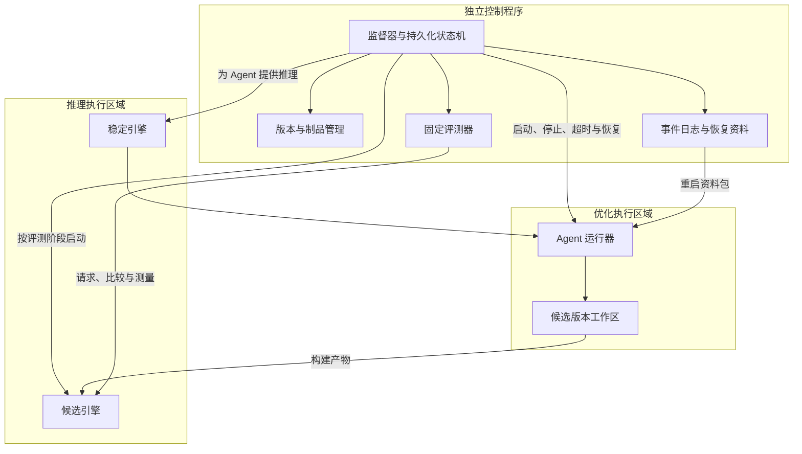

# 01：总体架构

## 1. 研究问题与目标

### 1.1 出发点

通用推理引擎需要覆盖多种模型、硬件和使用场景。VibeForge 研究的是：能否让 Agent 针对一个明确的部署目标，生成并迭代更适配的轻量引擎，同时将实验结果积累成可迁移的方法。

优化目标写成：

```text
输入：模型 M、硬件 H、工作负载 W、约束 C
输出：满足 C 的专用引擎 E，以及支持优化决策的知识 K

在正确性、内存、时延等约束内，优化预先选定的性能目标。
```

工作负载必须作为输入。例如，同一个模型在短输入低并发、长上下文和多请求服务下，适合的优化可能不同。

### 1.2 目标与边界

| 维度 | 设计要求 |
| --- | --- |
| 模型适配 | 明确支持的模型结构、权重格式、精度、分词与生成语义 |
| 硬件适配 | 根据计算、带宽、内存和互联特征生成实现与配置 |
| 轻量化 | 记录代码规模、依赖数量、部署体积与启动成本，按实验要求设置约束 |
| 自优化 | 自动形成假设、修改、验证、接受或回退，再开始下一轮 |
| 可恢复 | 进程退出和机器重启后，依赖持久化状态继续运行 |
| 可解释 | 每次变更都能关联修改原因、代码差异、原始测量与结论 |
| 可迁移 | 从局部实验形成有条件、有证据、可执行的优化知识 |

不要求首阶段支持所有模型或设备。模型权重和分词器原则上固定；量化等可能改变数值语义的优化，需要在实验开始前单独声明允许范围和质量约束。

## 2. 三个执行区域



三个区域是职责边界，不要求使用三台机器。单设备部署时，应由控制程序安排 GPU 或其他加速器的独占时间。

## 3. 组件及职责

| 组件 | 负责 | 输出或持久化内容 |
| --- | --- | --- |
| 监督器 Supervisor | 驱动状态机、进程管理、锁、超时、资源预算、恢复与停止 | 当前状态、执行租约、重试次数、恢复决定 |
| 画像采集器 Profiler | 记录模型、设备、软件环境与负载，检查实验前提 | 带哈希的目标画像 |
| Agent 运行器 | 组装上下文、连接稳定引擎、调用工具、执行优化任务 | 操作轨迹、代码变更、假设和分析 |
| 构建执行器 | 在隔离工作区准备依赖、编译并启动候选引擎 | 构建记录、产物哈希、启动结果 |
| 评测器 Evaluator | 按固定协议检查正确性、资源占用和性能 | 原始样本、汇总指标、有效性标记 |
| 准入判定器 | 按机器可执行规则决定接受、拒绝或复测 | 决策、原因码、所用证据 |
| 版本管理器 | 保存不可变版本、维护稳定指针、执行切换与回退 | 版本关系、发布记录、回退目标 |
| 日志与制品库 | 持久化事件、标准输出、报告和可复现材料 | 追加式事件流、实验目录、索引 |
| 分析与知识管理器 | 归纳瓶颈、收益和失败原因，维护经验规则 | 实验分析、规则版本、支持与反例 |

这些可以先实现为同一个控制程序中的模块，无需一开始拆成多个服务。

### 3.1 权限与修改边界

- Agent 的常规修改范围：候选引擎代码、候选专用配置、候选构建脚本。
- Agent 可以提交评测扩展建议；控制程序使用的参考实现、保留测试集和准入规则应独立维护、固定版本。
- 控制程序独占稳定指针和状态迁移的写入权；Agent 的文字建议不能直接触发版本提升。
- 控制程序自身升级走独立维护流程，避免与引擎实验同时改变恢复机制。

## 4. 目标画像

一次优化活动由以下四类信息唯一确定。画像变化后建立新的活动或实验分支，并重新建立基线。

| 画像 | 需要记录的特征 |
| --- | --- |
| 模型 | 权重和配置哈希、层数、隐藏维度、注意力类型、KV 头数、位置编码、专家结构、精度、分词器与模板 |
| 硬件 | CPU 架构与核数、加速器型号和数量、可用内存、缓存、内存类型、设备互联、共享或独立内存特征 |
| 软件 | 操作系统、驱动、编译器、计算运行时、依赖版本、编译选项、可复现环境标识 |
| 负载与约束 | 输入及输出长度分布、批大小、并发、上下文上限、采样方式、主目标、质量容差和资源预算 |

硬件型号属于静态身份；温度、频率、功率模式、后台负载属于每次测量都要记录的运行状态。

### 4.1 推荐的优化粒度

| 层次 | 候选变更示例 | 主要验证点 |
| --- | --- | --- |
| 部署配置 | 线程、绑核、批大小、内存分配参数 | 负载覆盖、资源约束与稳定性 |
| 运行时与调度 | KV cache 管理、请求调度、执行图、内存复用 | 多请求隔离、缓存生命周期、尾延迟 |
| 模型执行路径 | 融合算子、权重布局、静态形状特化 | 算子与整模型数值一致性 |
| 硬件算子 | 分块、向量化、设备内核、访存与并行策略 | 边界形状、数值误差、端到端收益 |
| 精度策略 | 允许范围内的低精度或量化实现 | 任务质量、误差累积、速度与内存权衡 |

可先复用可靠的基础计算库，再逐步替换热点路径。每个版本必须记录复用依赖与自行生成的代码，便于衡量真正的生成范围。

## 5. 引擎、Agent 与模型的关系

### 5.1 自托管关系

| 对象 | 含义 |
| --- | --- |
| 目标模型 | 被生成引擎部署的模型 |
| 稳定引擎 | 已通过准入、为下一轮 Agent 提供推理服务的引擎 |
| 优化 Agent | 使用目标模型的推理结果，通过工具修改引擎、提出分析的程序 |
| 候选引擎 | 本轮待测试版本，在准入前不能成为唯一恢复路径 |

基线方案中，目标模型也承担 Agent 的推理。但模型生成能力、工具协议和长上下文可靠性仍需单独验证；引擎正确并不自动保证 Agent 能完成代码优化任务。

### 5.2 自举与恢复

| 阶段 | 引擎来源 | 运行方式 |
| --- | --- | --- |
| 初始自举 | 可信参考后端或预先完成的最小引擎 | 生成第一版候选并建立初始稳定版本 |
| 正常自优化 | 当前稳定引擎 | 启动 Agent，修改下一候选版本 |
| 候选评测 | 独立启动候选；参考结果来自固定评测材料或可信后端 | Agent 暂停，设备资源用于评测 |
| 故障恢复 | 已保留的稳定或更早验证版本 | 控制程序先恢复服务，再重新启动 Agent |

如果使用外部更强模型协助自举或恢复，应将该模式单独记录。它与完全依赖本地目标模型的实验分别统计，避免混淆研究结论。

## 6. 资源调度与进程生命周期

单设备的默认时序：

```text
稳定引擎 + Agent 工作
→ Agent 提交候选与下一步恢复信息
→ 停止 Agent，释放稳定引擎占用
→ 构建、检查并独占设备评测基线和候选
→ 控制程序持久化决策，选择下一稳定版本
→ 重新启动稳定引擎
→ 新 Agent 读取恢复资料，开始下一轮
```

- 评测期间，不让 Agent 推理与基准测试争抢同一设备。
- 参考与候选内存不足以共存时，顺序加载；加载时间与稳态推理时间分开记录。
- 每轮可以重建引擎和 Agent 进程；整机重启作为独立恢复场景支持，不必成为每轮固定步骤。
- 控制程序由操作系统服务在开机后拉起，通过持久化状态恢复活动。

## 7. 最小交互契约

以下是逻辑接口，可由命令行或本地接口实现，首阶段不限定具体技术栈。

| 接口 | 输入 | 输出 |
| --- | --- | --- |
| `profile` | 模型位置、设备、负载定义 | 画像、环境检查结果 |
| `build` | 不可变候选源码、环境清单 | 构建产物、日志、哈希 |
| `start / stop / health` | 版本、运行配置、进程标识 | 就绪状态、退出码、资源占用 |
| `generate` | token 输入、生成参数、请求标识 | token 输出、完成原因、计时 |
| `evaluate` | 版本、测试协议、设备租约 | 正确性和性能报告、原始样本 |
| `submit_candidate` | 假设、父版本、差异、预期影响 | 候选标识、后续评测状态 |
| `resume_agent` | 稳定版本、恢复资料包 | 新会话标识、心跳、任务结果 |

候选交付时，必须说明：**改了什么、为什么预期有效、风险在哪里、应如何验证**。交付后的源码冻结，继续修改需创建新候选。
