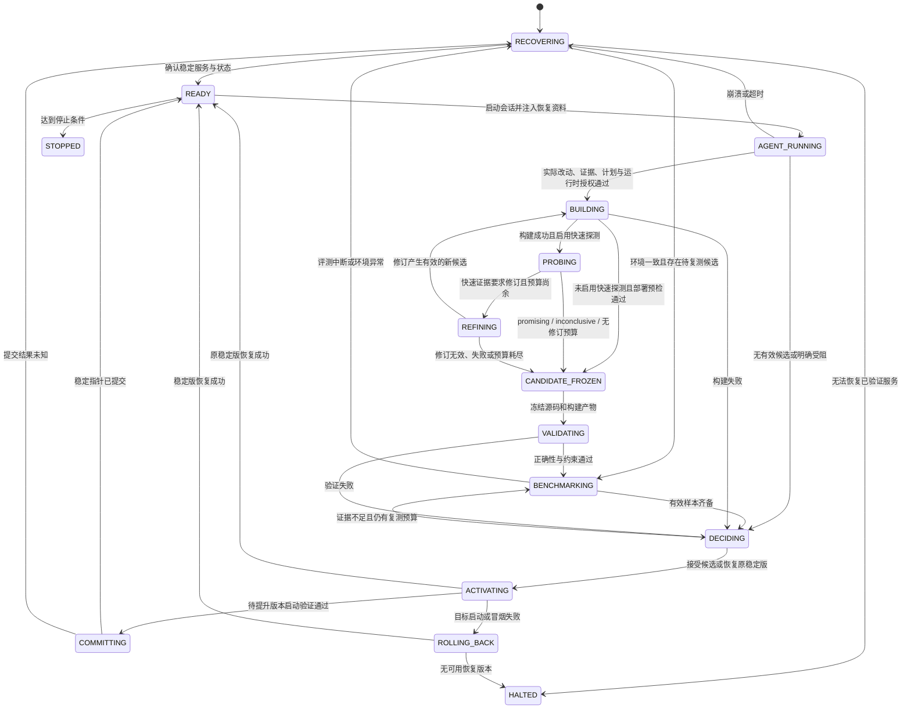

# 02：迭代流程、版本准入与故障恢复

> 本章同时描述目标态约束和现行闭环。当前实现与目标态不同之处会在对应段落明确标出；已验收范围以 [07](07-implementation-validation.md) 为准。

## 1. 关键对象

| 对象 | 含义 |
| --- | --- |
| `campaign_id` | 一次目标画像、负载和准入协议固定的优化活动 |
| `iteration_id` | 一次提案尝试的编号；即使无修改、被门槛拒绝或中断也保留档案 |
| `experiment_id` | 通过有效候选门槛后分配的实验编号；构建、正确性或性能拒绝仍属于有效候选的验证 |
| `candidate_id` | 冻结的候选源码、配置、依赖和构建产物组合 |
| `stable_ref` | 已完成评测、启动验证并提交的当前稳定版本 |
| `previous_stable_ref` | 最近一次被替换的稳定版本，用于发布后恢复 |
| `active_ref` | 当前实际启动的版本；切换过程中可能与 `stable_ref` 不同 |
| `operation_id` | 一次构建、评测、切换或回退操作的唯一编号，用于去重与恢复 |

“回退上一版本”在本系统中指**回到当前候选之前的已验证稳定版本**，不一定是时间上最近的源码提交。连续失败的候选不会覆盖稳定版本。

## 2. 启动前建立活动

1. 固定模型、硬件、软件环境与工作负载画像。
2. 固定正确性标准、主性能指标、保护指标、预算与停止条件。
3. 准备可信参考结果或参考实现，以及不可由候选修改的评测器。
4. 建立可运行的初始版本 `v0`，完成正确性、性能和 Agent 运行验证。
5. 保存 `v0` 的代码、依赖、构建产物与启动配置，设置初始 `stable_ref`。
6. 测试“停止后重新拉起稳定引擎”，确认恢复路径成立，再进入自动循环。

如果尚无合格的 `v0`，系统处于自举阶段，不能宣称已实现自托管自优化。

## 3. 一轮迭代

| 步骤 | 控制程序的动作 | Agent 的动作或交付 |
| --- | --- | --- |
| 1. 完成复盘 | 检查稳定服务，按最早待分析项清空队列；无进展则 `HALTED` | 引用该轮证据，记录假设状态、解释和下一步，再检索历史 |
| 2. 推理、自测并提出假设 | Agent 使用当前稳定引擎推理；宿主同步记录该会话普通请求 telemetry，并提供负载矩阵、真实加载配置及绑定稳定版的模块/算子诊断 | 实测瓶颈数值 → 原因假设 → 对应修改 → 场景及指标变化预测 → 固定验证方法 |
| 3. 生成候选 | 工具和控制器双重校验实际改动、配置兼容性、数值证据和运行前提；默认配置显式化无效 | 提交 v2 `experiment_plan` 和历史对照；无合理候选时 `report_blocked` |
| 4. 构建与快速探测 | 停止稳定引擎，按冻结配方构建临时候选；用小样本检查启动、正确性和目标指标方向。输出 `promising`、`inconclusive` 或 `revise`，只用于反馈，不得准入 | `revise` 且仍有预算时把证据交给一次受控修订；三种状态最终都进入正式门禁 |
| 5. 冻结并验证正确性 | 修订在独立工作区重新过差异、授权和构建门禁；随后冻结源码/产物并执行覆盖冻结场景的 token/logits/隔离检查 | 正确候选再作同条件瓶颈诊断 |
| 6. 正式评测性能 | 对冻结长度/输出/并发矩阵交错测量两版；总体与每场景退化分别检验 | quick probe 数据不进入正式统计 |
| 7. 形成决策 | 固定规则决定准入；另将预测指标与配对实测区间对照，生成 `verification.json` | 后续会话区分“预测是否得到支持”和“候选是否允许提升” |
| 8. 恢复服务 | 试启动接受的候选，或恢复原稳定版 | 通过最小推理与工具调用冒烟检查 |
| 9. 提交稳定版本 | 试启动通过后提交稳定指针；失败则回退 | 下一会话使用最终稳定引擎 |
| 10. 写恢复资料 | 保存事实、更新记忆索引并标记待分析；下一轮前设置分析屏障 | 独立分析会话完成 `reflection`；不能用占位文字清除待分析状态 |

默认每轮只验证一个主要优化假设。若一个优化必须联合修改多个模块，应明确依赖关系，并通过消融实验区分收益来源。

## 4. 持久化状态机



- 任意阶段机器重启后，入口均为 `RECOVERING`，再依据已持久化状态处理。
- 图中的失败路径需要写入状态和原因，不能只出现在进程日志中。
- `HALTED` 表示需要外部修复；`STOPPED` 表示按预算或任务条件正常结束。
- 决策事实由控制程序即时保存；语义分析标记 `analysis_pending`，由后续只读分析会话补全，完成之前不再规划候选。用户停止时允许保留队列，恢复后先处理。
- quick probe 和修订只缩短反馈周期，不改变正式准入标准。`promising` 表示方向值得继续，`revise` 表示建议修订，无法测量、超时或诊断基础设施失败记为 `inconclusive`；三者都不能直接接受或拒绝候选。每次修订都使用新工作区并重新过候选差异、修改表面授权、构建和探测；其单次性能数值不能与正式配对 A/B 混用。
- `profiling.enabled`、`probe.enabled`、`refinement.enabled` 分别控制稳定版画像、快速反馈和受控修订。各阶段 `timeout_seconds` 是包含该阶段全部请求的总截止时间，probe 的 `warmup` 次数在正式诊断样本前执行且不计入样本。
- 恢复中的测量需重新确认画像和设备租约；中断的测量组标记无效，使用新的尝试编号重跑。

当前恢复实现不会从中断点继续同一个候选的基准组：未完成尝试会被结算为 `interrupted_iteration` 并进入待分析队列，恢复稳定服务和完成复盘后再产生新的提案尝试。图中的 `RECOVERING → BENCHMARKING` 是目标态路径，尚未接入现行恢复流程。

## 5. 准入决策

| 结果 | 触发条件 | 动作 |
| --- | --- | --- |
| 提案门槛拒绝 | 没有实际修改、仅 Python 注释/空白改动、同父版本重复实现、计划或绑定观测证据不足 | 留下尝试记录；不构建、不跑正式性能、不消耗完成实验数 |
| 接受待激活 | 正确性通过，所有硬约束通过，主指标达到预设有效收益条件 | 记录提升意图，试启动候选；成功后提交稳定指针 |
| 正确性拒绝 | 数值、语义、接口、缓存或稳定性不符合标准 | 保留报告，恢复原稳定版本 |
| 性能拒绝 | 可信测量显示主指标退化，或违反保护指标 | 保留报告，恢复原稳定版本 |
| 无显著收益 | 改善不足、置信区间无法支持收益，且复测预算耗尽 | 不提升候选，保留原稳定版本 |
| 评测无效 | 热降频、后台争用、测试中断、环境不一致等污染结果 | 标记无效，修复条件后复测，不据此形成性能结论 |

“性能不升反降”必须由可比较的测量确认，不能仅依据一次运行的快慢。具体统计与指标口径见 [03：评测与日志](03-evaluation-and-observability.md)。

门槛使用规范化 Python AST、规范化 JSON 和运行源码指纹识别无改动及同父版本重复候选；修改数值参数仍属于不同候选。它保证计划可追溯、预测可验证，不保证每项改动必然改变热点或提高性能；这些结论由后续正确性和配对实验给出。编译源码按内容比较，不宣称能判定任意程序的语义等价。

### 5.1 基线选择

- 每轮主要比较候选与当前 `stable_ref`，因为下一轮要从当前最优合格版本继续。
- 目标态应同时保存最终稳定版相对初始 `v0` 的累计收益，区分单轮收益与总收益。当前实现保存 `initial_ref` 和逐轮配对收益，但活动结束时尚未自动重测最终稳定版相对 `v0` 的累计收益。
- 主指标或负载变化后重新建立比较活动，避免把不同目标下的版本混排。
- 对有价值但不符合当前目标的方案保留实验分支，不能直接替换稳定版本。

## 6. 版本切换作为可恢复事务

### 6.1 不可变发布单元

目标发布单元至少应包含：源码、运行配置、依赖锁定信息、编译参数、产物哈希、模型引用、评测证据与父稳定版本。仅保存 Git 提交不足以保证可恢复。

当前发布清单实际记录父版本、源码/运行产物文件哈希、运行解释器路径、活动配置哈希和证据引用；模型、环境版本及评测材料通过冻结活动配置、画像和活动档案关联。它能检测发布目录被修改并恢复相同源码，但尚未把 Python/CUDA 依赖环境封装或锁定为发布内的不可变单元。

- 模型权重可通过只读引用与哈希复用，无需每轮复制。
- 候选不能原地更新稳定版本的虚拟环境、共享库或生成产物。
- 即使重新构建失败，也应有上一个稳定构建产物可用于恢复。

### 6.2 提升顺序

```text
1. 持久化决策证据及 promotion_intent，记录源版本、目标版本、operation_id。
2. 保留 stable_ref，停止占用资源的旧服务。
3. 使用目标产物启动候选，检查就绪、最小推理、Agent 协议与工具冒烟。
4. 将 stable_ref、新旧版本关系和提交状态写入同一权威状态事务。
5. 持久化 promotion_committed，生成新的恢复资料包。
```

步骤 3 失败时恢复原 `stable_ref`。步骤 4 前发生重启时，不默认目标已提升，由恢复程序核实事务并恢复已提交的稳定版本。

建议使用支持事务的本地状态数据库；若采用文件，则需使用同文件系统的临时文件写入、刷盘、原子替换及父目录刷盘。事件日志与状态无法一起提交时，通过 `operation_id` 和提交标记进行幂等对账，不能假设两者天然原子。

### 6.3 回退顺序

1. 持久化 `rollback_intent`，写明原因、故障版本和已验证的恢复目标。
2. 停止故障版本及其子进程，确认设备资源被释放。
3. 从恢复目标的不可变制品启动服务，执行健康与最小推理检查。
4. 更新实际运行状态；若回退已提交的发布，则以新事务同步稳定指针。
5. 保存 `rollback_completed`，向新 Agent 提供故障证据。

回退后保留失败源码、日志和样本。恢复失败只允许在预设次数内尝试更早的验证版本；仍失败则进入 `HALTED`，避免无限重启。

## 7. 异常恢复矩阵

| 异常 | 恢复策略 | 必须保存的证据 |
| --- | --- | --- |
| Agent 崩溃或上下文耗尽 | 终止残留工具进程；将未冻结工作区标为未完成；从稳定引擎启动新会话 | 最后操作、未提交差异、退出码、心跳时间 |
| 构建失败或超时 | 判定构建拒绝，恢复稳定服务 | 命令、环境、输出、退出码、超时点 |
| 候选错误、OOM 或崩溃 | 终止候选，记录失败，恢复稳定服务 | 失败用例、资源峰值、堆栈、设备错误 |
| 测量被中断 | 保留部分样本但不纳入正式汇总；按预算重跑测量组 | 已完成样本、无效原因、运行状态 |
| 候选提升过程中断 | 读取提升意图和提交状态，核实实际进程，幂等恢复 | 事务状态、源目标版本、已完成步骤 |
| 控制程序重启 | 重新取得唯一写入锁，核实子进程、设备租约和状态 | 旧实例标识、进程启动标识、恢复动作 |
| 整机重启或掉电 | 开机服务拉起控制程序，读取最后已提交稳定版本，重建日志索引和恢复资料 | 启动标识、持久化状态、未完成操作 |
| 驱动或环境发生变化 | 暂停直接比较；重验稳定版本，必要时新建活动 | 环境差异与新的画像哈希 |
| 日志不可写或磁盘不足 | 停止接受新实验，不执行无法审计的版本提升；优先保持或恢复稳定服务 | 最后成功写入位置、存储错误 |
| 复盘失败或未清除待分析项 | 进入 `HALTED`，保留已有结果和分析轨迹；不得继续规划 | 目标编号、工具反馈、分析结果与待分析队列 |

键盘中断会记录 `interrupted_iteration`、清理本活动进程并保持停止；中断尝试不计入完成实验。崩溃恢复依据已提交提升事务对账，同时补齐该轮 `decision.json` 与待分析记录，避免恢复后的 Agent 只有数据库状态而找不到证据文件。

### 7.1 避免重复执行

- 一个活动只允许一个控制程序持有写锁，避免两个恢复实例同时切换版本。
- PID 需结合进程启动时间或系统启动标识确认，不能只凭 PID 判断进程身份。
- 未完成操作先核实实际结果，再决定重试；重复执行不能产生第二次提升或重复结算。
- Agent 的长任务使用心跳和截止时间区分“正在工作”与“已经失联”。

## 8. 停止与人工接管条件

开始活动时配置以下边界，具体值由实验目标决定：

| 条件 | 行为 |
| --- | --- |
| 达到 `max_iterations` 个完成实验，或墙钟/会话时间预算 | 保存最后稳定版本，正常停止 |
| 达到提案总数 `max_proposals` 或连续无有效候选 `max_stalled_attempts` | 保存受阻原因并停止，避免无限空转 |
| 连续基础设施故障、重复同类错误 | 有界重试，超过上限后停止并报告 |
| 无法恢复任何验证版本 | 进入 `HALTED`，保留证据，等待修复 |
| 需要改变模型、验收标准或主目标 | 结束或挂起当前活动，显式建立新活动 |

自动自优化不意味着无限运行。每次停止都应生成最终稳定版本、累计收益、未解决问题和恢复入口。

新增计数分别为 `proposal_attempts`、`valid_candidates`、`completed_experiments`；兼容字段 `completed_iterations` 保留尝试编号语义，不代表有效实验或性能提升次数。默认 `max_proposals = 3 × max_iterations`、`max_stalled_attempts = 3`，可在新活动配置中修改。构建/正确性拒绝有实验结论；基础设施中断没有可信性能结论。历史活动恢复时按既有候选记录对账，不改写历史报告中的旧计数含义。

分析需要预留预算。正常结束前，使用最终稳定引擎启动只读 Agent 会话，补齐最后一轮分析，不再生成候选。若故障使分析无法完成则进入 `HALTED`，报告保留 `analysis_pending` 和原始证据，供修复后补全；用户主动停止不强行启动复盘。
