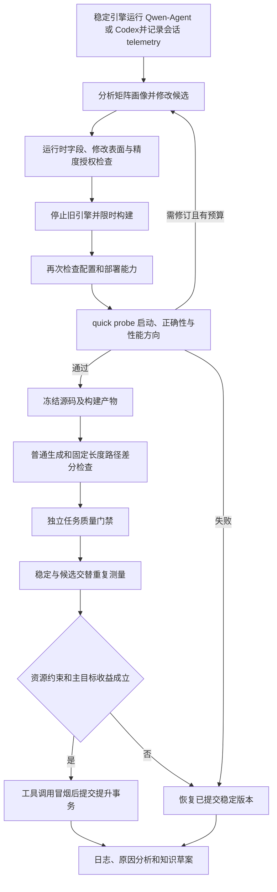

# 09：多模型、多硬件、多精度与需求驱动的引擎优化

## 1. 当前系统的单位

一个活动固定模型身份、设备、工作负载、评测标准和预算；不同组合使用不同活动。

| 输入 | 配置位置 | 控制器如何使用 |
| --- | --- | --- |
| 模型 | `configs/models/` | 权重格式、结构、tokenizer、上下文、内存估算 |
| 硬件 | `configs/hardware/` | CPU/CUDA/ROCm 设备选择，可选架构与名称约束 |
| 人工初始引擎 | `configs/engines/` | 源码目录、适配器、加载器、依赖、构建命令 |
| 运行精度 | `configs/precision/` | 计算、权重、量化、KV cache、累加精度 |
| 优化授权 | `configs/optimization/` | 是否允许精度搜索及完整配置白名单 |
| 个性化需求 | `configs/requirements/` | 主目标、资源限制、接口、文字需求 |
| 负载与评测 | `configs/workloads/`、`configs/evaluation/` | 并发、长度、差分误差、独立质量标准 |

仍由人提供可运行初始引擎。VibeForge 复制它、建立稳定版本，Agent 只编辑候选工作区。

## 2. 支持程度

| 能力 | 当前实现 | 本机验证范围 |
| --- | --- | --- |
| 多模型 | Transformers 自动/显式选择 causal LM、image-text 模型类的文本路径 | 小型随机 GPT-2、Llama 的真实 CPU 推理；Qwen35B 未完整加载 |
| 自定义模型格式 | safetensors 单文件/分片；GGUF；用户 manifest | 格式校验测试；GGUF/manifest 的实际运行库由人工适配器提供 |
| 多硬件 | `cpu`、`cuda[:index]`、`rocm[:index]`，推理环境探测设备能力 | CPU 小模型实测；CUDA 已完成 A100 上 27B NF4 加载、生成和诊断，尚无成功优化收益；ROCm 仅有契约和预检测试 |
| 非量化精度 | FP32、FP16、BF16 | 小型真实模型 FP32、BF16；FP16 需按设备验收 |
| 在线量化 | CUDA Transformers 的 bnb NF4、FP4、INT8 | NF4 已在 A100 上实测 Qwen3.5-27B 权重加载、五场景生成和 606 个量化层校验；FP4/INT8 仍只有加载参数与门禁测试 |
| 其他量化 | `custom:<name>` + 声明支持的 Python 适配器 | 扩展契约；不自动提供 AWQ/GPTQ/GGUF/FP8 的内核 |
| 自定义构建 | argv 命令、截止时间、工作区/缓存写入限制、发布制品哈希 | 产物冻结与越界写入拒绝测试；没有声称实测 CUDA 内核编译 |
| 个性化优化 | 吞吐、完整请求 P95、RSS、启动时间、发布体积 | 统计方向、资源保护和闭环门禁测试 |

`capabilities` 显示框架契约；`profile` 检查当前组合。任意模型格式、精度和设备的笛卡尔积不保证可运行。

## 3. 组合配置示例

```json
{
  "name": "my-model-latency",
  "model": {"name": "my-model", "path": "/models/my-model", "max_context": 4096, "reserve_gib": 2},
  "hardware": "configs/hardware/cuda.json",
  "engine": "configs/engines/transformers.json",
  "precision": "configs/precision/bf16.json",
  "requirements": "configs/requirements/latency.json",
  "optimization": "configs/optimization/fixed.json",
  "workload": "configs/workloads/smoke.json",
  "evaluation": "configs/evaluation/local.json",
  "agent": "configs/agent/local.json",
  "runtime_python": "/path/to/inference/bin/python",
  "budget": {"max_iterations": 3, "max_seconds": 3600, "agent_seconds": 240, "max_failures": 3}
}
```

可复制 `configs/campaigns/local-model.json` 后修改。CPU 改用 `cpu.json` 和 FP32；ROCm 使用 ROCm PyTorch，模型设备设为 `rocm:0`。若旧模型配置已经含 `device`，它优先于硬件配置的默认设备，切换硬件时一并修改。

```bash
.venv/bin/vibeforge capabilities
.venv/bin/vibeforge profile --config configs/campaigns/local-model.json
.venv/bin/vibeforge run experiment-001 --config configs/campaigns/local-model.json
```

Agent 仍是 Qwen-Agent `Assistant`，通过稳定引擎调用当前模型。模型本身必须有可用聊天模板和工具调用能力；能加载权重不等于能胜任 Agent。控制器在独立、可超时的 worker 中检查工具调用。

## 4. 精度契约

完整精度对象示例：

```json
{
  "weight_dtype": "int4", "compute_dtype": "bfloat16",
  "quantization": "bnb-nf4", "double_quant": true,
  "kv_cache_dtype": "auto", "accumulation_dtype": "auto"
}
```

| 字段 | 含义与限制 |
| --- | --- |
| `compute_dtype` | 支持 float32、float16、bfloat16，接受 fp32/fp16/bf16 别名 |
| `weight_dtype` | 非量化时与计算精度相同；NF4/FP4 为 int4；bnb INT8 为 int8 |
| `quantization` | none、bnb-nf4、bnb-fp4、bnb-int8、custom:名称 |
| `kv_cache_dtype`、`accumulation_dtype` | 内置后端仅接受 auto；显式控制需专用适配器 |
| `double_quant` | bnb 4bit 的二次量化开关 |

- 权重存储精度与运行精度分开记录；内存估算按 tensor 元素数量和目标精度计算。
- 内存需求是权重估算 × 1.08 + `reserve_gib`；不是 KV/激活/编译峰值的保证。自定义量化可给 `model.estimated_weight_bytes`。
- 已经打包量化的 checkpoint 要使用匹配格式的 Python 适配器；内置 Transformers 会拒绝其 `quantization_config`，避免自动加载行为与声明精度不一致。
- 旧配置 `model.dtype` / `model.quantization` 仍可读取，归一化后使用完整契约。候选 `engine.json` 的旧字段必须与新契约一致。
- 声明精度、代码校验与抽样评测不能证明每个算子的真实计算精度；专用后端仍应接受实现审查和更强数值测试。

## 5. 固定精度与精度搜索

| 模式 | 行为 |
| --- | --- |
| 默认固定精度 | Agent 改变精度会被拒绝，稳定版本恢复 |
| 白名单搜索 | 活动明确允许；只可选择 `allowed_precisions` 的完整条目 |

搜索必须在启动前配置：

1. `optimization.allow_precision_changes=true`，至少两种允许配置。
2. `evaluation.correctness_mode=approximate`，固定 token 一致率、重复参考次数、共识阈值、atol/rtol、可选归一化 RMS 上限。
3. `evaluation.quality.command`、`files`、`min_scores`、`max_regressions`。
4. 初始引擎通过质量下限；其质量分数冻结为后续所有候选的比较基准，避免逐轮累积退化。

示例接线见 `configs/campaigns/precision-search-example.json`。示例误差阈值和三条质量用例仅说明接口，需要按研究任务校准和扩充。初始 BF16 无法部署时，该活动仍会预检阻塞；系统不会偷偷先改成量化版本。

### 独立任务质量接口

控制器执行人工声明的命令，不执行候选提供的评分逻辑。

| 输入/输出 | 内容 |
| --- | --- |
| 命令占位符 | `{python}` 为控制解释器；`{project}`、`{url}`、`{request}`、`{output}` |
| request.json | 引擎 URL、活动/版本/源码/配置/画像标识、精度 |
| result.json | `{"passed": true, "metrics": {"accuracy": 0.95}}`，可附逐条结果 |
| 门禁 | 命令成功、结果合法且有限；按 `quality.repeats` 重复并取各指标最差值；所有分数 ≥ min_scores、相对初始最差分数下降 ≤ max_regressions |
| 完整性 | `files` 声明脚本、数据集、配置与相关依赖文件；冻结哈希，每次评测前校验 |

提供 `scripts/evaluation/quality_cases.py`，支持精确答案、包含和正则匹配；`benchmarks/cases/task-quality-core.json` 提供基础独立真值用例。它只能作最低门禁，也可替换为第三方领域评测器。外部程序是受信任组件，应声明全部影响评分的文件。阈值与评分代码变更需要新活动。

## 6. 正确性与性能路径



任何阶段失败都会进入恢复路径。发布冻结发生在构建完成后，编译产物才能参与哈希和回退。

参考默认来自人工初始引擎，但明确标记为 `regression_baseline_not_ground_truth`。每个用例默认重复 3 次，记录 token 变体、主变体共识和 logit 中位数/波动包络；严格模式共识不足会拒绝自举。非测试模型使用这种自参考时必须另配独立任务质量门禁及相对退化上限，不能用“与自己一致”代替答案正确。也可用 `evaluation.reference_path` 提供独立后端生成的 schema v3 参考 JSON：文件及内部哈希都会检查，必须声明 `provenance.oracle=independent` 并覆盖当前固定长度性能请求。

| 检查 | 实现 |
| --- | --- |
| 严格模式 | 相同输入 token、输出属于重复参考中已观察序列、基线共识门槛、抽样 logits、重放与请求隔离；要求参考完全一致时设共识阈值为 1 |
| 近似模式 | 对重复参考集合取最大 token 一致率并应用数值阈值，强制执行独立质量评测 |
| logits | 固定种子抽样，默认最多 64 个，可设 1—4096；重复采集形成中位数和波动包络，先以 reference_atol/reference_rtol 限制参考自身波动，再检查候选 prefill 和主参考续写输入 |
| 性能路径 | 参考和正确性检查包含 `fixed_length=true`；每次计时请求也检查输出长度与 token |
| 并发 | 1—64 个 HTTP 客户端，检查交错请求；服务目前串行调用后端，包含排队成本，未实现动态批处理 |

长上下文、多模态、逐层数值、长时稳定性与完整 logits 仍需要专门实验；不能由短用例通过推导出来。

外部参考还会验证变体计数、共识、数值包络及全部普通和性能用例覆盖。有限参考集合不等于输出分布等价；质量重复执行也不是置信区间。重复质量的原始 request/result 位于 `quality/runs/0001/` 等目录，根目录 `quality/report.json` 汇总最差值和逐次结果。配置默认值、限制及旧活动迁移见 [03：当前正确性实现](03-evaluation-and-observability.md#当前实现v3-组合门禁)。

## 7. 个性化目标与限制

| `requirements.objective` | 方向 | 计量范围 |
| --- | --- | --- |
| throughput | 越大越好 | 控制侧输出 token 总数 / 窗口时间 |
| latency_p95_seconds | 越小越好 | 客户端单次完整 HTTP 请求时延 P95，包含排队 |
| peak_rss_bytes | 越小越好 | 计时窗口内对引擎进程树的 RSS 采样峰值 |
| startup_seconds | 越小越好 | 创建引擎进程至健康检查通过 |
| source_bytes | 越小越好 | 冻结发布清单包含的源码与制品文件总字节数 |

`limits` 可为除吞吐外的上述指标设置上限。每组候选都要满足上限，再按配对 bootstrap 区间判定主目标收益；最小化目标使用 `1 - candidate / baseline`，收益为正表示改善。

- RSS 不包含独立显存，可能重复计算共享页，也可能漏掉采样间短峰值和加载期峰值。
- 发布体积不含模型权重、Python 环境和系统依赖。它可衡量实现规模，不能替代完整部署包体积。
- TTFT/TPOT 仍来自后端时间戳；当前无独立逐 token 流式测量，不作为新增主目标。
- ROCm 的资源准入依赖设备探测；GPU 进程独占检查目前依赖 NVIDIA 工具。无法取得清单时会标记无效，需配置适合的监控方案后开展严格独占实验。
- 文字 `description` 会进入 Agent 上下文，程序只强制执行结构化约束。目前没有能耗目标或 Pareto 多目标选择。

## 8. 自定义引擎和构建

初始目录至少包含 `engine.py` 和 `engine.json`。Python 桥接层提供：

| 函数 | 返回/职责 |
| --- | --- |
| load(config) | 加载模型和运行配置 |
| generate(prompt, max_new_tokens, fixed_length=False) | text、input_ids、token_ids；固定长度模式必须完成指定工作量 |
| logits(input_ids, indices) | indices、values，返回给定输入最后位置的 logits |
| chat(messages, max_new_tokens) | 文本任务质量评测入口 |
| chat_completion(messages, tools, max_tokens, **kwargs) | text、tool_calls、usage，供 Qwen-Agent 调用 |

GGUF 只检查头部、版本和文件尺寸；模型元信息与 tensor 完整性由对应运行库负责。自定义模型 manifest 示例：

```json
{
  "model_type": "my-runtime", "prequantized": true,
  "vocab_size": 32000,
  "artifacts": [{"path": "weights.bin", "sha256": "替换为实际 SHA256"}]
}
```

`artifacts` 路径必须位于 manifest 所在目录下。未声明 SHA256 时只检查尺寸/修改时间；safetensors 只检查头部、边界、清单及相关元信息，没有自动重新校验全部权重内容。

`engine.build_command` 使用 argv 数组，允许 `{workspace}`、`{cache}`、`{python}`；`{python}` 为推理解释器。命令在独立进程组中限时运行，只能写工作区和构建缓存。实际运行必需的产物放 `runtime/`；`build/`、`.cache/`、`__pycache__/` 不进入发布。编译器和依赖需要提前安装，不由 Agent 改写环境。

`optimization.allowed_surfaces` 在活动开始时冻结可修改层级：

| 表面 | 允许的变化 |
| --- | --- |
| `runtime_config` | 运行参数，如线程数和 attention/cache 开关 |
| `execution_adapter` | `engine.py` 及候选本地 Python 模块的执行路径 |
| `cache_policy` | cache 实现、启用方式及相关适配逻辑 |
| `scheduler` | `request_scheduler=serialized_lock|concurrent_requests|microbatch`；`microbatch` 是完整请求静态合批，不等于 paged continuous batching |
| `native_kernel` | `.cu/.cpp/.c/.h/.hpp` 源码及其加载路径 |

候选修改 `engine.json` 时，控制器按字段映射检查所需表面；未授权即在构建前拒绝。`native_kernel` 还要求引擎配置已有冻结的非空 `build_command`。Transformers 初始配方使用 `build_native.py`：没有 `kernels/` 源码时为空操作，有原生源码时通过推理环境编译到候选运行目录。原生源码、加载代码和发布内产物都进入内容哈希，并继续经过启动、正确性、质量和配对性能门禁；允许编译不代表内核正确或更快。

## 9. 产物、恢复和知识

| 产物 | 路径，相对 `var/` |
| --- | --- |
| 完整配置快照 | `campaigns/<id>/manifest.json`、`configs/` |
| 初始质量基准 | `campaigns/<id>/initial-quality.json`、`bootstrap/quality/` |
| 候选能力预检 | `campaigns/<id>/iterations/NNNN/preflight.json` |
| 独立质量证据 | `campaigns/<id>/iterations/NNNN/quality/report.json` 汇总；`quality/runs/0001/` 等目录保留每次 request/result/report、命令与原始输出 |
| 并发计时与资源 | `campaigns/<id>/iterations/NNNN/benchmarks/samples.jsonl`，含 attempt/group、输出哈希、时延、RSS |
| 性能观测与计划验证 | `iterations/NNNN/observation.json`、`candidate-gate.json`、`verification.json`；相对活动目录 |
| 实验记忆与反思 | 活动 `memory/index.json`、每次尝试 `memory.json` 和 `analysis.md`，只读分析会话在 `final-analysis/<目标编号>/` |
| 精度与画像 | `profiles/<hash>.json`；数据库 `version_profiles` 绑定每个版本 |
| 构建产物 | `releases/<version>/runtime/`，可追溯到工作区 |
| 优化知识 | `campaigns/<id>/knowledge-drafts/`，含来源/目标画像、精度、目标、差异和判定 |

恢复时保留已经提交的提升，取消未提交意图，并逐条补齐待分析迭代。Agent 从稳定版本的实际精度和画像恢复上下文。构建、质量评测和 Agent 冒烟均有进程所有权记录与超时。

当前提案流程先过实际改动、修改表面、绑定观测、收益上限、数值预测和历史对照门槛，再进入构建、可选 quick probe/修订与正式评测；全部待分析项完成后才允许规划下一候选。`max_iterations` 计完成实验，`max_proposals` 和 `max_stalled_attempts` 限制无效尝试；诊断参数由 `profiling` 配置。详细契约见 [02](02-iteration-and-recovery.md)、[03](03-evaluation-and-observability.md) 和 [08](08-qwen-agent-integration.md)。

知识条目先成为草案；只有经审查并标为 `local_validated` 或 `cross_config_validated` 的规则才会进入检索。不同精度不会共用一个画像身份；跨配置泛化仍需重复实验。

新活动保存 campaign `schema_version=4`。历史 v1/v2/v3 活动仍可查看日志和状态；v4 加入统一循环协议、Agent telemetry、矩阵画像、quick probe 与修订契约，不直接续跑旧活动，应保留原证据并建立新活动。外部独立参考文件自身仍使用 reference schema v3。不要手改历史 manifest 哈希来绕过检查。
