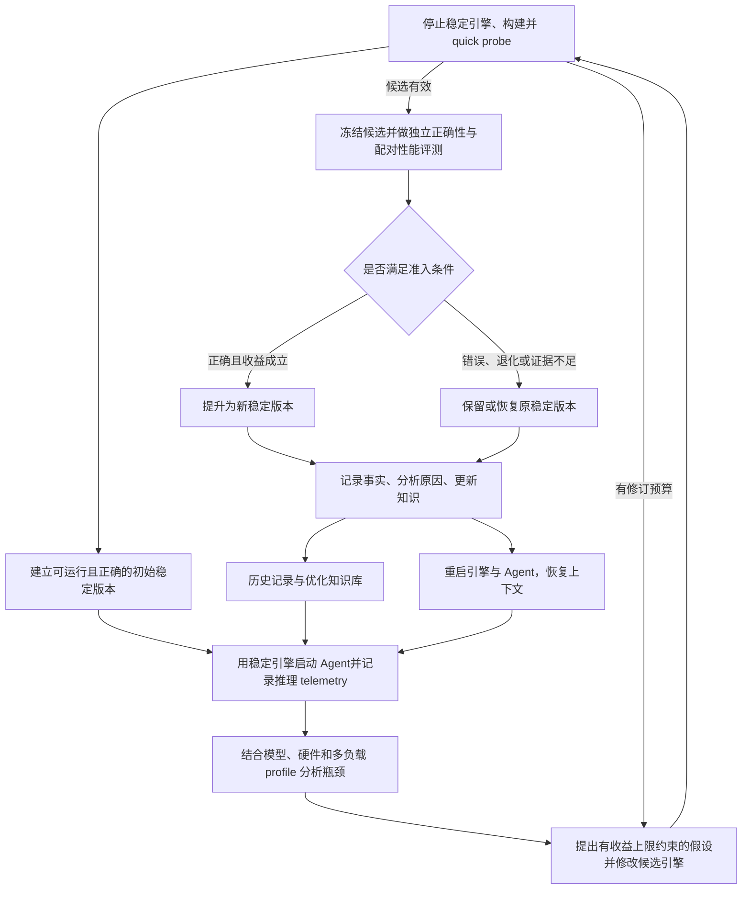

# VibeForge：面向模型与硬件的推理引擎自优化系统

> 01—04 描述研究目标与设计约束；05 描述工程布局；06—09 记录运行、验收、Agent 接入和多样化引擎契约。设计目标不等于已经验证的能力。

## 1. 核心设想

VibeForge 使用 Agent 为给定的**模型、硬件和工作负载**生成并持续优化轻量推理引擎。每轮修改都经过独立评测：正确性不满足要求或性能确认退化时回退；收益得到验证后，将候选版本提升为新的稳定版本。

引擎为 Agent 提供本地推理能力，Agent 再优化引擎。独立控制程序管理整个循环，持久化记录每一步，使引擎、Agent 乃至机器重启后都能恢复实验。

研究产出分为两层：

| 产出 | 内容 |
| --- | --- |
| 专用推理引擎 | 在指定约束下，适配当前模型、硬件及负载的可运行实现 |
| 可迁移优化知识库 | 哪些特征对应哪些瓶颈、应采用什么优化、如何实现，以及证据与失效条件 |

## 2. 系统闭环

上述操作由控制程序驱动。Agent 可以退出或崩溃，循环的状态与恢复能力仍然保留。

## 3. 文档导航

| 文档 | 重点 |
| --- | --- |
| [01：总体架构](01-system-architecture.md) | 研究边界、组件职责、引擎生成范围、模型与硬件画像、自举方式 |
| [02：迭代与故障恢复](02-iteration-and-recovery.md) | 每轮流程、状态机、版本准入、事务切换、回退、重启与断电恢复 |
| [03：评测、日志与上下文恢复](03-evaluation-and-observability.md) | 正确性、性能、收益判定、实时日志、持久化结构、重启资料包 |
| [04：知识库与实施路线](04-knowledge-and-roadmap.md) | 优化经验抽象、规则验证、跨配置迁移、研究实验、分阶段落地 |
| [05：项目目录与文件放置规范](05-project-layout.md) | 实际工程目录、各文件夹职责、代码与配置入口、运行档案和命名规则 |
| [06：本地运行与恢复](06-local-operations.md) | 安装、Qwen 配置、活动命令、日志定位、故障恢复和测试 |
| [07：实现与验收报告](07-implementation-validation.md) | 模块实现、工程测试、CPU 闭环、真实小模型、Qwen 部署阻塞证据与限制 |
| [08：Qwen-Agent 接入](08-qwen-agent-integration.md) | Assistant、原生工具协议、独立 worker、日志与验收范围 |
| [09：多样化引擎系统](09-diverse-engine-system.md) | 多模型/硬件/精度、质量门禁、需求目标、构建扩展、配置和迁移 |
| [10：持续迭代与收益复测](10-continuous-improvement.md) | 迭代可靠性、模型源码诊断、进度记录、计时协议和初末版本复测 |

## 4. 全系统共同约束

1. **正确性先于性能**：通过正确性和资源约束后，才比较性能收益。
2. **控制程序独立生存**：控制程序不依赖被优化引擎产生决策，也不因 Agent 重启而丢失状态。
3. **稳定版本始终可恢复**：候选修改在独立工作区完成，稳定版本、依赖和构建产物保持可用。
4. **评测口径预先固定**：Agent 可以建议新测试，不能自行降低当前实验的验收标准。
5. **先持久化，后执行关键动作**：切换、回退、重启均留下意图与结果记录。
6. **失败也是研究数据**：错误、退化、无显著收益的实验全部保留，并进入后续分析。
7. **结论必须有适用边界**：一个配置上的成功，先形成局部经验；跨配置验证后再推广。

## 5. 最小可行闭环

首先选择一个模型、一台设备和一组固定负载，打通以下路径：

> 可运行初始引擎 → Agent 推理及会话自测 → 多负载瓶颈画像与分层历史检索 → 原因假设、收益上限、修改和指标预测 → quick probe 与可选修订 → 正确性与独立性能验证 → 接受或回退 → 事实、策略与反例落盘 → 完成复盘后继续。

首阶段的成功标准是**循环可靠、实验可复现、决策可解释**。更复杂的算子生成、自动归因和跨硬件知识迁移，在该闭环稳定后逐步加入。
